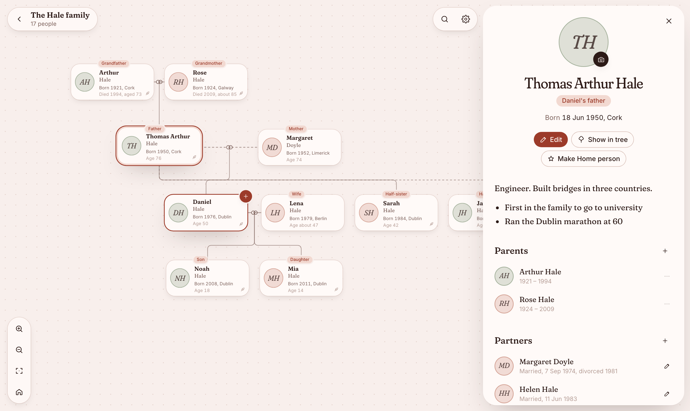

# Familiatree

A simple, private family tree that you host yourself.

<picture>
  <source media="(prefers-color-scheme: dark)" srcset="docs/screenshot-dark.png">
  
</picture>

- Add people, their dates, a photo and their story.
- See parents, partners and children in one clear tree.
- Keep all data on your own server, in one file.
- Let AI agents read and change the tree through a REST API.

## Start

With Docker:

```sh
git clone https://github.com/abcumpanici/familiatree.git
cd familiatree
docker compose up -d
```

Then go to `http://localhost:3000`.

To use Home Assistant or to run it without Docker, read [the self-hosting guide](docs/self-hosting.md).

> **Warning:** the app has no login. Keep it on your home network or on a VPN.

## AI agents

Give your agent `http://<your server>:3000/llms.txt`. The API docs are at `/api/docs`.

## Develop

```sh
bun install
bun run dev
```

Read [AGENTS.md](AGENTS.md) for the rules and the checks.

## Licence

[AGPL-3.0](LICENSE)
